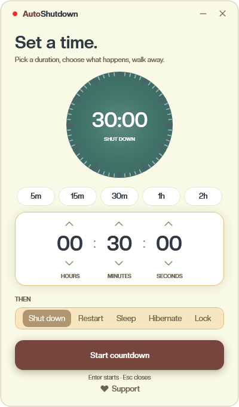
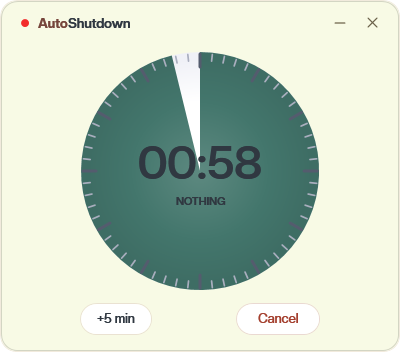
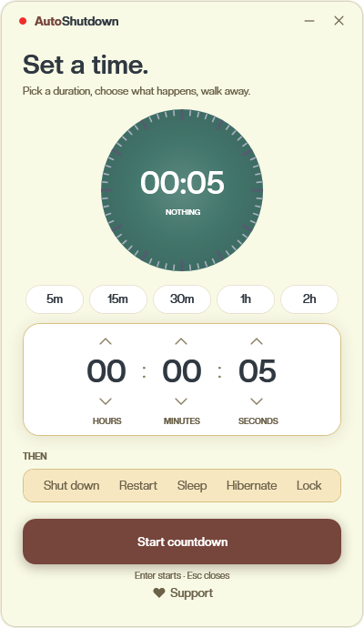

# AutoShutdown

<p align="center">
  
</p>

A Windows auto-shutdown timer with a flat pie-clock UI. Pick a duration, choose what happens when it reaches zero, and walk away.

| Setup | Countdown | Time's up |
| --- | --- | --- |
|  |  |  |

## What it does

- **Countdown to a power action** — shut down, restart, sleep, hibernate or lock the workstation.
- **Presets and fine control** — 5 min / 15 min / 30 min / 1 h / 2 h, or set hours, minutes and seconds with the steppers.
- **Live preview** — the pie and the scheduled action update as you edit the time.
- **Cancel with confirmation** — the X button and `Esc` ask before throwing the countdown away.
- **Remembers the last setup** — duration and action are restored on the next launch.

## The design

- **A whole pie, not a ring** — the remaining time is a solid wedge eaten away clockwise from 12 o'clock, driven by a monotonic `Stopwatch` at ~33 fps so it never drifts with the system clock. No glow, no pulse — the only animation is the pie finishing its count (plus a soft colour cross-fade when you pick an action).
- **Flat "sand & forest" palette** — `#F8FAE5` background, white cards, `#43766C` pie, `#76453B` primary button, `#B19470` selected pill. No gradients anywhere.
- **Creato Display** — bundled under the [SIL Open Font License](Fonts/LICENSE-CreatoDisplay-OFL.txt), in Regular, Medium, Bold and ExtraBold weights. Tabular digits keep the clock from jittering.
- **Softly rounded window** — a borderless 400 × 690 portrait window with a 16 px rounded clip (Windows 10 ignores the native DWM rounding, so the chrome does it manually).
- The window stays on top while a countdown is running.

## Running it

Requires Windows 10/11 and the **.NET 10 Desktop Runtime** (or the .NET 10 SDK).

```powershell
dotnet run --project .\AutoShutdown\AutoShutdown.csproj
```

Build a release executable:

```powershell
dotnet publish .\AutoShutdown\AutoShutdown.csproj -c Release -r win-x64 --self-contained false -p:PublishSingleFile=true -o .\dist
```

Then run `dist\AutoShutdown.exe`.

## Safety

- No administrator rights are needed. The app enables `SeShutdownPrivilege` for its own process only.
- Shutdown and restart use `ExitWindowsEx` with `EWX_FORCEIFHUNG` — hung apps are closed, healthy apps get a chance to save.
- Sleep and hibernate use `SetSuspendState`; lock uses `LockWorkStation`.
- The countdown is monotonic: changing the system clock does not shorten or extend it.
- No network access, no telemetry.

## Keyboard

| Key | Action |
| --- | --- |
| `Enter` | Start the countdown (setup screen) |
| `Esc` | Close the cancel dialog / ask to cancel / close the app |

## Files

| Path | Purpose |
| --- | --- |
| `%APPDATA%\AutoShutdown\settings.json` | Last duration and action |
| `%APPDATA%\AutoShutdown\autoshutdown.log` | Diagnostics |

## Development flags

| Flag | Purpose |
| --- | --- |
| `--demo` | Start a 75-second countdown that performs **no** power action |
| `--demo-seconds <n>` | Same, with a custom length |
| `--shot <file> [--shot-delay <ms>]` | Render the window to a PNG and exit (used for the screenshots above) |

Demo runs never overwrite your saved settings.
